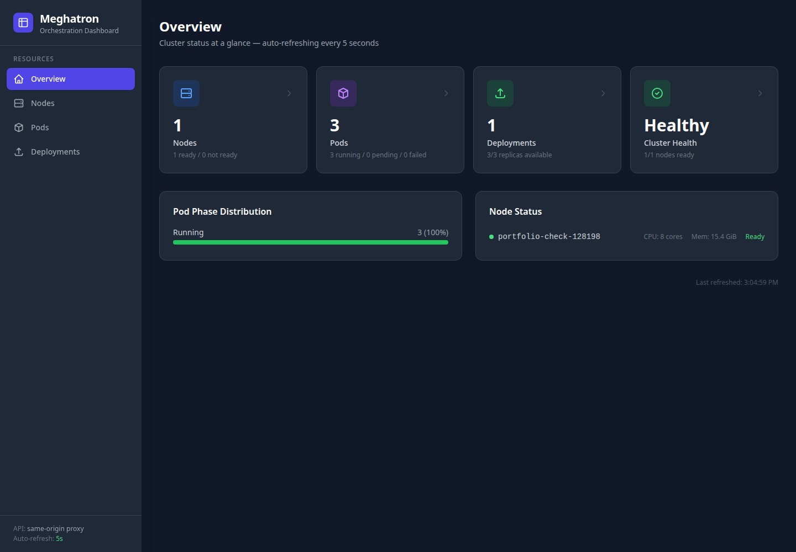
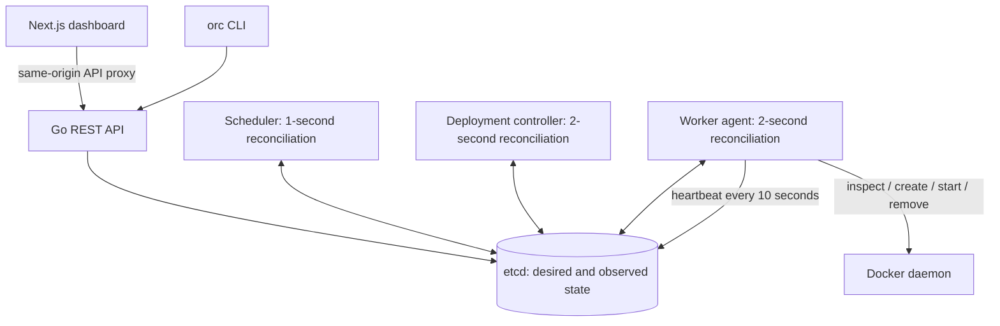

# Meghatron

[](LICENSE)

A container orchestration system built in Go, with an etcd control plane, Docker worker agents, a CLI, and a Next.js dashboard. Meghatron demonstrates how desired-state reconciliation, resource scheduling, ownership, and recovery fit together behind a Kubernetes-style API.

**Learning project.** Designed for a trusted local lab, with one control-plane process and one worker agent per Docker daemon. It is not a production Kubernetes replacement.



## What works

- **Desired-state deployments:** create replicas, scale up/down, replace terminal replicas, and delete owned pods with container cleanup.
- **Resource-aware scheduling:** filter fresh workers by remaining CPU/memory and explicit host-port reservations, then use a deterministic best-fit score. Pending pods retry when capacity becomes available.
- **Restart recovery:** discover containers using stable Docker ownership labels, adopt them after an agent restart, and apply `Always`, `OnFailure`, or `Never` restart policies.
- **Consistent state:** etcd compare-and-swap writes reject duplicate creates and stale updates. Deletion intent remains persisted until container cleanup succeeds.
- **Observed status:** availability requires all containers to be observed running. Workers with heartbeats older than 30 seconds are excluded from new scheduling.
- **Management interfaces:** REST API, API-only CLI, and a responsive dashboard with creation, scaling, deletion, and actionable pod errors.
- **Verification:** race-enabled behavioral tests, an isolated real-Docker lifecycle test, and a prepared GitHub Actions workflow.

## Architecture



A deployment creates pods with a stable owner UID. The scheduler assigns unbound pods to eligible workers. Each worker compares assigned pods against labeled Docker containers, performs missing lifecycle actions, and records observed status. Deletion marks intent first; the worker removes containers before removing the pod record. The controller removes a terminating deployment only after its owned pods are gone.

See [design decisions and failure behavior](docs/architecture.md).

## Run locally

Requirements: **Go 1.25+**, **Node.js 22.13+**, npm, Docker with Compose, and `make`. The scripted demo also needs `curl` and `jq`.

```bash
git clone https://github.com/Megha-TR/Meghatron.git
cd Meghatron
make etcd-up
make build
cd web
npm ci
cd ..
```

Run these in three terminals from the repository root:

```bash
# Terminal 1 — control plane (loopback only by default)
./bin/orchestration-server

# Terminal 2 — worker (capacity is detected from its Docker daemon)
./bin/node-agent --node-name worker-1

# Terminal 3 — dashboard
cd web && npm run dev
```

Open [the dashboard](http://localhost:3000). The dashboard currently shows the `default` namespace; the API, scheduler, controller, worker and CLI support other namespaces.

```bash
./bin/orc deployment create web nginx:1.28-alpine 3
./bin/orc deployment get web
./bin/orc pod list
./bin/orc deployment scale web 1
./bin/orc deployment delete web
```

Deletion is asynchronous. A terminating resource remains visible until the worker finishes cleanup. Containers intentionally stay running when an agent process stops; restarting that agent adopts them.

### Five-minute demonstration

With the control plane and worker running:

```bash
make demo
```

The script creates a uniquely named deployment, waits for three available nginx replicas, scales to one, then deletes it and waits for cleanup. Watch the dashboard during the run. It does not delete unrelated workloads.

To demonstrate recovery manually, create a deployment, restart only its node agent, and verify the same container IDs remain. Stop one of its containers with `docker stop <container-id>` and observe the agent restart it on its next reconciliation.

## Resource and port semantics

CPU accepts cores (`"0.5"`, `"1"`) or millicores (`"100m"`). Memory accepts `Ki`, `Mi`, `Gi`, decimal `K/M/G`, and bytes with `B`. Bare memory numbers retain the original MiB convention. Internally, CPU uses millicores and memory uses bytes.

Each container defaults to requests of `100m` CPU / `64Mi` memory and limits of `1` CPU / `256Mi` memory. A request must not exceed its limit. Scheduling reserves requests across all assigned pods; Docker enforces limits. Allocatable capacity currently equals Docker-reported capacity without a host-system reserve.

A `containerPort` documents/exposes a port inside Docker; it does **not** publish a host port. An optional `hostPort` publishes to loopback and is reserved by the scheduler. For example:

```json
{"name":"app","image":"nginx:1.28-alpine","ports":[{"containerPort":80,"hostPort":8081}]}
```

This container is reachable at [localhost:8081](http://localhost:8081). Replicas can share container port 80, but cannot share the same host port and protocol on one worker. Service networking is not implemented; service creation returns `501` rather than a nonfunctional IP.

## API

| Operation | Endpoint |
| --- | --- |
| Create pod | `POST /api/v1/pods` |
| List / inspect / delete pod | `GET /api/v1/pods/{namespace}`, `GET` / `DELETE /api/v1/pods/{namespace}/{name}` |
| List / inspect workers | `GET /api/v1/nodes`, `GET /api/v1/nodes/{name}` |
| Create deployment | `POST /api/v1/deployments` |
| List / inspect / delete deployment | `GET /api/v1/deployments/{namespace}`, `GET` / `DELETE /api/v1/deployments/{namespace}/{name}` |
| Scale deployment | `PATCH /api/v1/deployments/{namespace}/{name}/scale` with `{"replicas": 2}` |
| Liveness / storage readiness | `GET /health`, `GET /ready` |

```bash
curl -fsS http://127.0.0.1:8080/api/v1/deployments \
  -H 'Content-Type: application/json' \
  -d @examples/web-deployment.json
```

Creates return `201`, deletion requests `202`, invalid input `400`, missing resources `404`, duplicate/stale writes `409`, storage failures `503`, and non-JSON write bodies `415`. Public create operations generate server-owned IDs, timestamps and status; clients cannot choose assignment or ownership.

The CLI uses only the API. Set `--server` / `MEGHATRON_SERVER` for a different API and `--namespace team-a` for another namespace (global flags precede commands). Set `MEGHATRON_API_URL` before starting/building the dashboard to change its API proxy target.

## Checks

```bash
make check          # formatting, go vet, race-enabled Go tests
make build          # all three binaries
make coverage       # coverage for the six core behavioral packages
make web-check      # TypeScript, ESLint, production Next.js build (after npm ci)
make e2e            # temporary etcd + real Docker deployment/recovery/scale/delete
```

`make e2e` uses a random loopback etcd port and unique container ownership labels. It cleans up its containers and etcd instance on exit. It needs Docker access and image registry access on the first run. Ordinary `go test ./...` skips this integration test unless `MEGHATRON_TEST_ETCD` is set.

The [GitHub Actions workflow template](docs/ci-workflow.yml) runs backend checks, dashboard checks and dependency auditing, and the real-container lifecycle test. To enable it, add its contents as `.github/workflows/ci.yml` through GitHub or credentials with workflow permission. The credentials used to publish this update cannot create workflow files, so hosted CI is not enabled yet.

## Scope and tradeoffs

- One active scheduler/controller process is supported. Local serialization plus etcd version checks does not provide distributed leader election or transactional cluster-wide resource reservations.
- A lost worker becomes NotReady. Its pods are **not** automatically moved: safe failover needs fencing to avoid duplicate execution on a partitioned worker. Cleanup waits for that worker to return.
- Readiness means Docker reports every container running; there are no application liveness/readiness probes, restart backoff, or rolling image updates.
- Containers within a pod do not share a network namespace. There is no overlay network, Service routing, DNS, volumes, secrets, or RBAC.
- API and etcd are unauthenticated. Defaults bind exposed ports to loopback; do not expose this stack to untrusted networks. Docker access is privileged.
- Reconciliation uses polling/full lists rather than etcd watches. Scale/performance claims require a separate benchmark.
- Old unlabeled containers and old deployment pods from the original prototype are not adopted automatically. Use a fresh demo state or explicitly remove only your old prototype resources before switching versions.

See [local verification results](docs/validation.md) for the checks run against this implementation.

## Troubleshooting and cleanup

- **Pending pod:** inspect its message on the Pods page. Check for a ready worker, insufficient capacity, host-port conflicts, image pull failures, or Docker errors.
- **Terminating pod:** its worker must be reachable and able to remove Docker containers. Records remain until cleanup succeeds.
- **API unavailable:** check `/health` and `/ready`; `docker compose logs etcd` shows storage errors. Dashboard fetch errors preserve the last successful snapshot.
- **Docker unavailable:** start Docker and check `docker info`. Use a distinct daemon for each worker agent; two agents on one daemon would misrepresent capacity.

Delete your deployments/pods and wait for cleanup before stopping the agents. `make etcd-down` stops etcd while retaining its data volume. Do not remove the etcd data volume while managed workloads remain running.

## License

[MIT](LICENSE)
